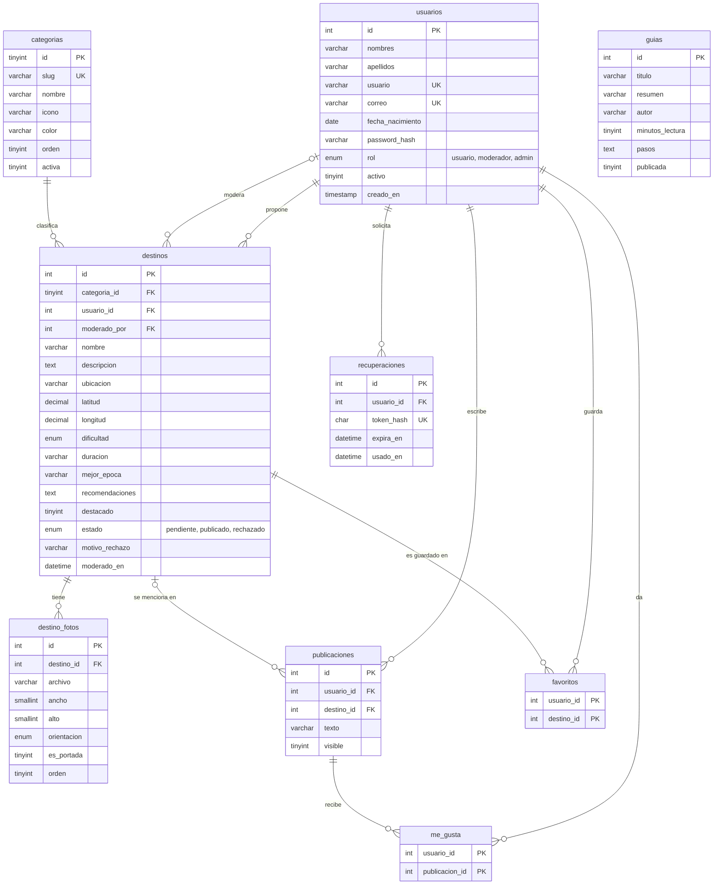

# Modelo de datos · EcoBuesaco

Base de datos relacional `ecobuesaco` (MySQL / MariaDB, InnoDB, `utf8mb4`) con **9 tablas**.

## Diagrama entidad-relación

**Decisiones de diseño**

- Las **propuestas de destinos** no tienen tabla aparte: son filas de `destinos` con `estado = 'pendiente'`.
- `me_gusta` y `favoritos` tienen **clave primaria compuesta**, por lo que un usuario no puede repetirlos.
- Las **fotos** se guardan en disco (`uploads/destinos/`) y la base solo guarda el nombre del archivo y sus dimensiones.
- Las **categorías** son datos administrables (color, icono y estado), no valores fijos en el código.
- `recuperaciones` guarda solo el **hash** del código, no el código.
- No se almacenan documentos de identidad.

## Diccionario de datos

### usuarios
| Columna | Tipo | Nulo | Descripción y reglas |
|---|---|---|---|
| id | INT UNSIGNED, AUTO_INCREMENT | No | **PK** |
| nombres | VARCHAR(80) | No | Nombres de la persona |
| apellidos | VARCHAR(80) | No | Apellidos |
| usuario | VARCHAR(20) | No | Nombre de usuario. **Único**; 3 a 20 letras, números o guion bajo |
| correo | VARCHAR(150) | No | **Único**; se guarda en minúsculas |
| fecha_nacimiento | DATE | No | Se valida la edad mínima (`EDAD_MINIMA`, hoy 13) |
| password_hash | VARCHAR(255) | No | Resultado de `password_hash()`; nunca la contraseña |
| rol | ENUM('usuario','moderador','admin') | No | Por defecto `usuario` |
| activo | TINYINT(1) | No | 1 = puede iniciar sesión; 0 = cuenta desactivada |
| creado_en | TIMESTAMP | No | Fecha de registro |

### categorias
| Columna | Tipo | Nulo | Descripción y reglas |
|---|---|---|---|
| id | TINYINT UNSIGNED, AUTO_INCREMENT | No | **PK** |
| slug | VARCHAR(30) | No | Identificador interno. **Único**; no cambia al editar |
| nombre | VARCHAR(50) | No | Nombre visible |
| icono | VARCHAR(10) | No | Emoji |
| color | VARCHAR(7) | No | Color hexadecimal (`#rrggbb`) |
| orden | TINYINT UNSIGNED | No | Posición en las listas |
| activa | TINYINT(1) | No | 0 = no se puede elegir en propuestas ni aparece como filtro |

### destinos
| Columna | Tipo | Nulo | Descripción y reglas |
|---|---|---|---|
| id | INT UNSIGNED, AUTO_INCREMENT | No | **PK** |
| categoria_id | TINYINT UNSIGNED | No | **FK** → categorias.id |
| usuario_id | INT UNSIGNED | Sí | **FK** → usuarios.id. Quien lo propuso (NULL = contenido del equipo) |
| nombre | VARCHAR(120) | No | Nombre del destino |
| descripcion | TEXT | No | De 20 a 2000 caracteres |
| ubicacion | VARCHAR(160) | No | Vereda, sector o referencia escrita |
| latitud | DECIMAL(9,6) | Sí | Entre -90 y 90 (CHECK) |
| longitud | DECIMAL(9,6) | Sí | Entre -180 y 180 (CHECK) |
| dificultad | ENUM('Fácil','Moderada','Exigente') | No | |
| duracion | VARCHAR(40) | No | Tiempo aproximado |
| mejor_epoca | VARCHAR(120) | No | Opcional (puede quedar vacío) |
| recomendaciones | TEXT | Sí | Una recomendación por línea |
| destacado | TINYINT(1) | No | 1 = aparece en Inicio |
| estado | ENUM('pendiente','publicado','rechazado') | No | Solo `publicado` se ve públicamente |
| motivo_rechazo | VARCHAR(255) | Sí | Lo escribe el moderador al rechazar o retirar |
| moderado_por | INT UNSIGNED | Sí | **FK** → usuarios.id. Último moderador |
| moderado_en | DATETIME | Sí | Fecha de la última revisión |
| creado_en / actualizado_en | TIMESTAMP | No | Control de fechas |

### destino_fotos
| Columna | Tipo | Nulo | Descripción y reglas |
|---|---|---|---|
| id | INT UNSIGNED, AUTO_INCREMENT | No | **PK** |
| destino_id | INT UNSIGNED | No | **FK** → destinos.id (borrado en cascada) |
| archivo | VARCHAR(255) | No | Nombre aleatorio dentro de `uploads/destinos/` |
| ancho / alto | SMALLINT UNSIGNED | No | Dimensiones en píxeles |
| orientacion | ENUM('horizontal','vertical','cuadrada') | No | Se calcula al subir |
| es_portada | TINYINT(1) | No | La primera foto es la portada |
| orden | TINYINT UNSIGNED | No | Posición en la galería (máximo 5 fotos) |
| creado_en | TIMESTAMP | No | |

### guias
| Columna | Tipo | Nulo | Descripción y reglas |
|---|---|---|---|
| id | INT UNSIGNED, AUTO_INCREMENT | No | **PK** |
| titulo | VARCHAR(150) | No | |
| resumen | VARCHAR(255) | No | |
| autor | VARCHAR(100) | No | |
| minutos_lectura | TINYINT UNSIGNED | No | |
| pasos | TEXT | No | Un paso por línea |
| publicada | TINYINT(1) | No | 1 = visible |
| creado_en | TIMESTAMP | No | |

### publicaciones
| Columna | Tipo | Nulo | Descripción y reglas |
|---|---|---|---|
| id | INT UNSIGNED, AUTO_INCREMENT | No | **PK** |
| usuario_id | INT UNSIGNED | No | **FK** → usuarios.id (cascada) |
| destino_id | INT UNSIGNED | Sí | **FK** → destinos.id (si se borra el destino queda en NULL) |
| texto | VARCHAR(1000) | No | De 3 a 1000 caracteres |
| visible | TINYINT(1) | No | 0 = eliminada (borrado lógico) |
| creado_en | TIMESTAMP | No | |

### me_gusta
| Columna | Tipo | Nulo | Descripción y reglas |
|---|---|---|---|
| usuario_id | INT UNSIGNED | No | **PK compuesta** y **FK** → usuarios.id |
| publicacion_id | INT UNSIGNED | No | **PK compuesta** y **FK** → publicaciones.id |
| creado_en | TIMESTAMP | No | |

### favoritos
| Columna | Tipo | Nulo | Descripción y reglas |
|---|---|---|---|
| usuario_id | INT UNSIGNED | No | **PK compuesta** y **FK** → usuarios.id |
| destino_id | INT UNSIGNED | No | **PK compuesta** y **FK** → destinos.id |
| creado_en | TIMESTAMP | No | |

### recuperaciones
| Columna | Tipo | Nulo | Descripción y reglas |
|---|---|---|---|
| id | INT UNSIGNED, AUTO_INCREMENT | No | **PK** |
| usuario_id | INT UNSIGNED | No | **FK** → usuarios.id (cascada) |
| token_hash | CHAR(64) | No | SHA-256 del código enviado por correo. **Único** |
| expira_en | DATETIME | No | Vence a los 60 minutos |
| usado_en | DATETIME | Sí | NULL = aún sin usar; sirve una sola vez |
| creado_en | TIMESTAMP | No | |

## Reglas de integridad (claves foráneas)

| Relación | Al borrar el padre |
|---|---|
| destinos.categoria_id → categorias | **Restringe** (no se borra una categoría con destinos) |
| destinos.usuario_id / moderado_por → usuarios | Queda en NULL |
| destino_fotos, favoritos, me_gusta, recuperaciones → su padre | Se borran en cascada |
| publicaciones.usuario_id → usuarios | Se borra en cascada |
| publicaciones.destino_id → destinos | Queda en NULL |